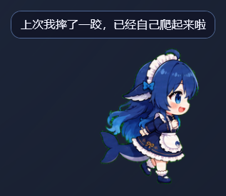
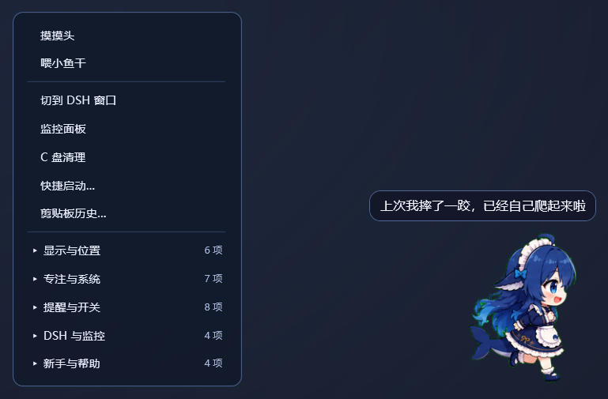
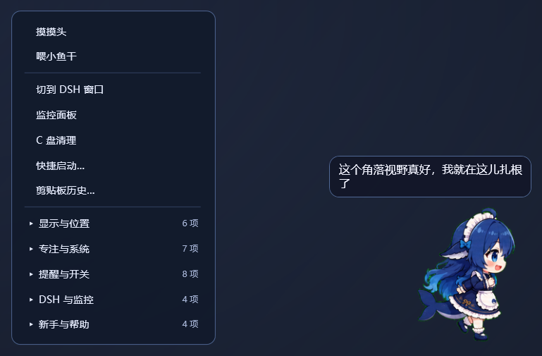
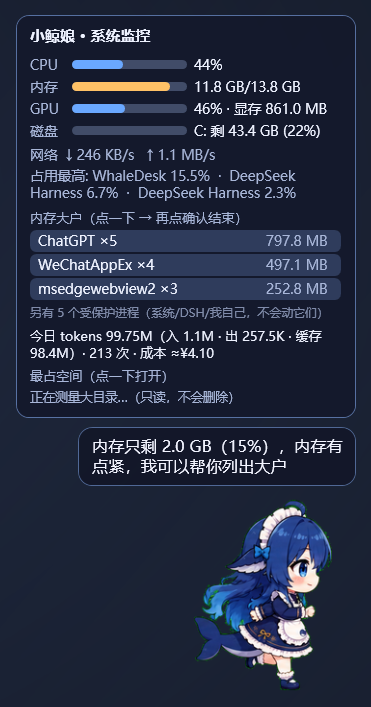
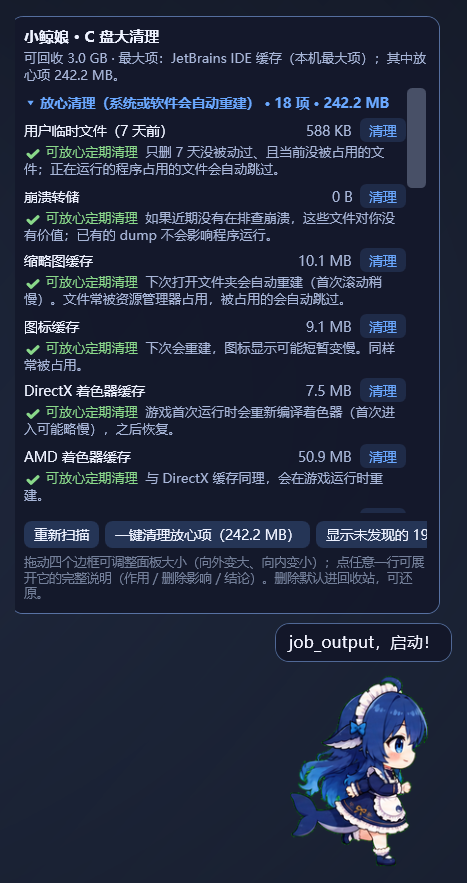
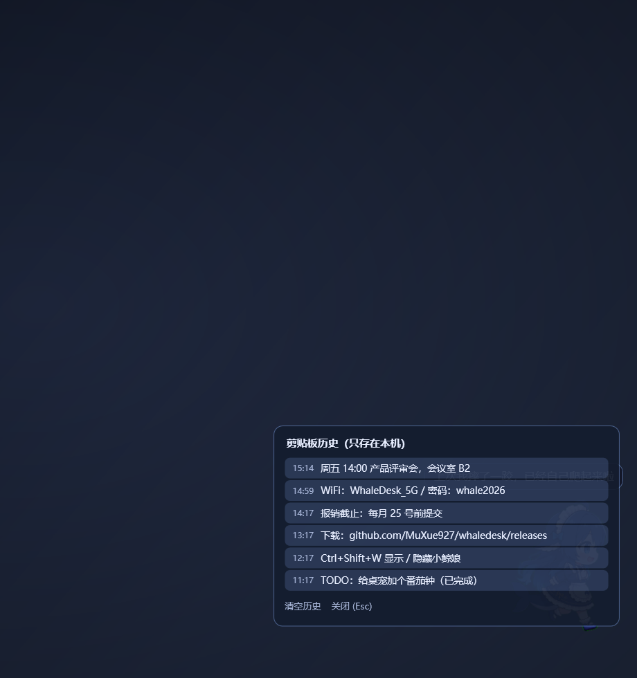
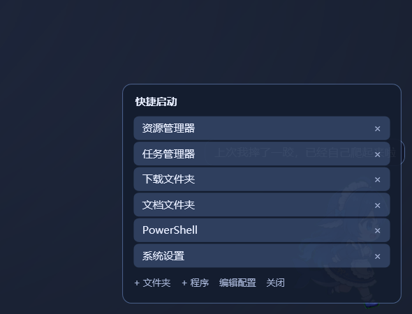
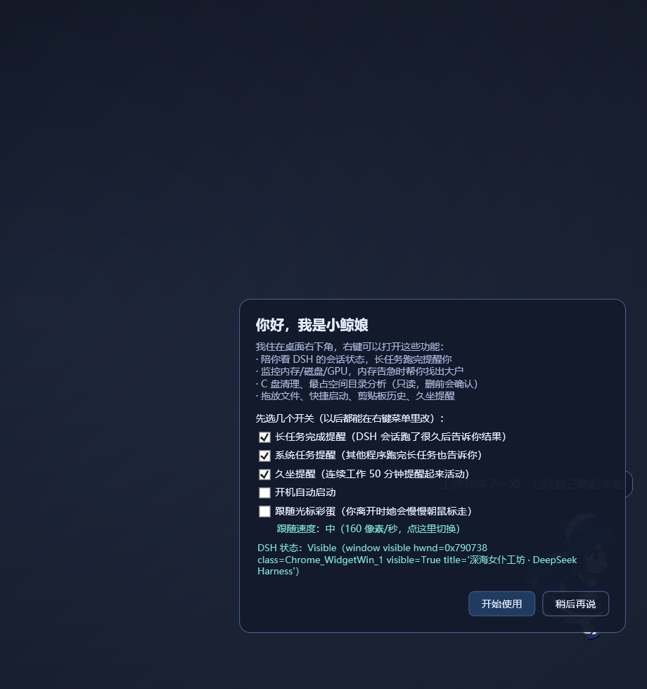
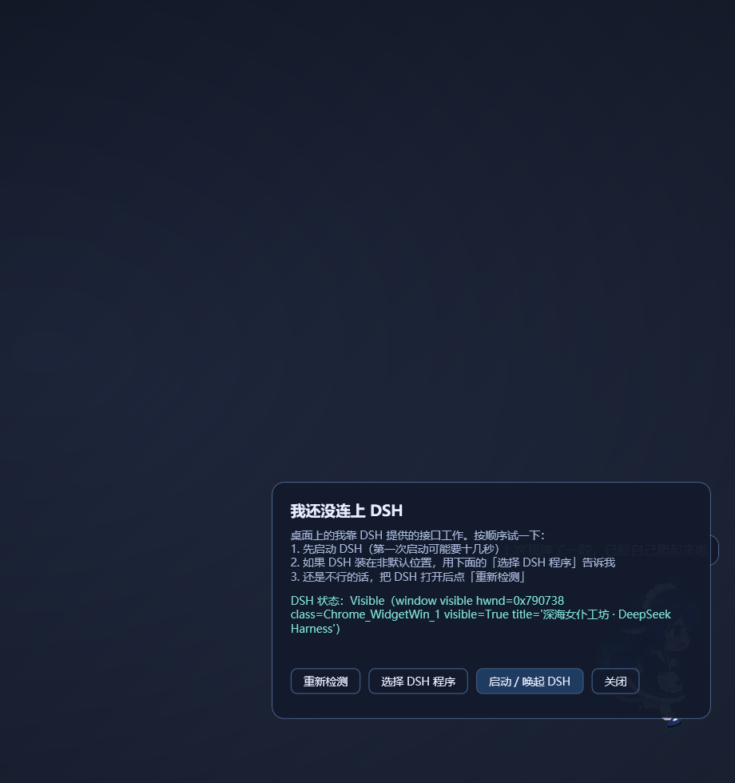
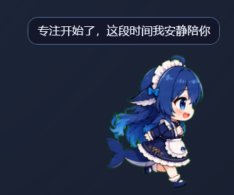

# 小鲸娘桌面伴侣 · WhaleDesk

> 一个住在桌面右下角的 **.NET 9 WPF 桌面宠物**：陪你看 DSH 会话状态、监控内存/磁盘/GPU、
> 做 C 盘清理与空间分析，还有跟随光标、专注番茄钟、剪贴板历史、久坐提醒等小功能。
> 可独立运行；检测到 DSH 时会读取本地会话状态（只读，不走网络）。

| | |
|---|---|
| **最新版本** | `v0.24.3`（2026-10-18） |
| **平台** | Windows 10 / 11 x64 |
| **运行时** | 框架依赖版需要 [.NET 9 桌面运行时](https://dotnet.microsoft.com/download/dotnet/9.0)；或使用自包含版（无需安装 .NET） |
| **许可** | 代码 MIT；精灵素材版权归原作者（见文末） |
| **安装包** | `WhaleDesk-0.24.3.zip`（框架依赖，5.82 MB）/ `WhaleDesk-0.24.3-selfcontained.zip`（自包含，67.4 MB，无需 .NET） |
| **SHA256** | `045a0979872ae4b268471113af351743c8edd3719607ad67f61da3c91f3fc1cd`（以 `release\SHA256.txt` 为准） |

## 平台支持

| 平台 | 状态 | 说明 |
|---|---|---|
| **Windows 10 / 11（x64）** | ✅ 已支持并实测 | 唯一受支持的平台；126 项自检 + 清理演练 + 真机截图验证 |
| macOS | ❌ 不支持 | WPF + Win32 API 无法在 macOS 运行；跨平台需重写 UI 与服务层 |
| Linux | ❌ 不支持 | 同上；目标用户较少，暂无计划 |

**跨平台说明**：本项目的窗口/透明/置顶/点击穿透/多屏 DPI/托盘、注册表自启动、回收站、
进程与 GPU 性能计数器、前台窗口联动都依赖 Windows 专属 API。要支持 macOS/Linux 需把 UI
换成 Avalonia/MAUI 并重写各平台服务层，且 macOS 还需 Apple 开发者签名与 notarization；
**没有真机验证前不会宣称支持**。

> 截图统一在**中性深色背景**下拍摄（`scripts\neutral-backdrop.ps1`），不包含任何个人桌面内容；
> 可用 `scripts\capture-doc-shots.ps1` 一键重新生成（含 12 张）。

---

## 界面预览

| 桌面宠物 + 状态气泡 | 右键菜单（分组 + 二级飞出） |
|---|---|
|  |  |

| 菜单分组与条目 | 系统监控卡片 |
|---|---|
|  |  |

| C 盘清理卡片 | 剪贴板历史（文本 + 图片） |
|---|---|
|  |  |

| 快捷启动 | 新手引导 |
|---|---|
|  |  |

| DSH 接入指南 | 专注模式（番茄钟） |
|---|---|
|  |  |

---

## 它能做什么

### 1. 桌面陪伴
- 常驻桌面右下角：透明、置顶、不抢焦点；点击穿透，鼠标移到她身上才可交互
- 可拖动、贴边吸附、多显示器/混合 DPI 正确摆放、记忆位置；托盘图标 + 热键 `Ctrl+Shift+W`
- 互动：单击、拖拽、长按、连击、双击、喂食/摸头/说句话
- 彩蛋：角落安家、整点报时、深夜关怀、久别重逢、连击/摇晃眩晕、**跟随光标**（可调速）
- 台词随 DSH 会话阶段变化（思考/工具/等待/失败）；DSH 不在时用本地台词

### 2. DSH 联动（可选）
- 只读访问本机回环接口 `/api/pet/state`：会话阶段、气泡、亲和度、多会话
- **端口自动发现**：DSH 0.2.1-rc.2 的接口端口是动态的（实测 64688），自动探测并记住
- 长任务完成/失败提醒；会话状态浮标（阶段 + 计时）；断开自动降速轮询并安静重连
- 菜单可直接打开/隐藏 DSH；未安装时给出接入指南（见截图）

### 3. 系统监控
- CPU、内存（可用/总量/百分比）、磁盘（C 盘分级预警）、GPU（引擎/显存）、网络速率
- 进程占用排行（按名称聚合）；内存告急时分级提示，可结束非关键进程
- 前台应用太久提醒；系统长任务（复制/编译）完成提醒

### 4. 清理与空间
- C 盘分级预警（正常/注意/警告/危险）
- 清理卡片：常见缓存目标分级；**执行前二次确认，删除进回收站**（可还原）
- 空间分析：最占空间目录、深挖（3 层/预算 9 秒）、清理、忽略、保留清单（★）
- 不确定的目标只给路径，不删除

### 5. 效率小工具
- 拖放：拖文件到她身上 → 复制路径 / 复制内容 / 复制到目录
- 快捷启动：常用程序/命令（含终端 PowerShell），见截图
- 剪贴板历史：**文本 + 图片**（图片存本地 PNG，最多 10 张，点击放回剪贴板）
- 久坐提醒（连续 50 分钟）、番茄钟（自动时长：DSH 会话 45 / 一般 30 / CPU 高 25 / 深夜 20 / 内存紧张 15）
- 专注联动：番茄钟运行期间静音闲聊与彩蛋，保留重要提醒

### 6. 更新与诊断
- 自动更新检查（GitHub Releases，被动式：气泡 + 菜单项，不静默安装）
- 内置自检 **126 项**、清理演练 33 项（dry-run）
- **28 个 `--probe-*` 诊断探针**（菜单/监控/清理/DSH/热插拔/跟随/图片历史/更新/剪贴板/启动器/插件…）
- 日志：`%LOCALAPPDATA%\WhaleDesk\build\whaledesk.log`

---

## 安装

### 方式 A：框架依赖版（推荐，约 6 MB）
1. 下载并解压 `WhaleDesk-0.24.3.zip`（或自包含版 `WhaleDesk-0.24.3-selfcontained.zip`）
2. 解压后直接双击 `install.cmd` 安装（**大多数电脑不会弹提示**）。若提示「未知发布者/已阻止」：右键 → 属性 → **常规页最下方**勾选「解除锁定」（或运行 `scripts\unblock-files.ps1`）
3. 双击 `install.cmd`，安装到 `%LOCALAPPDATA%\WhaleDesk` 并创建桌面快捷方式「小鲸娘」
4. 前置要求：已安装 **.NET 9 桌面运行时**（Desktop Runtime x64）

### 方式 B：自包含版（无需 .NET，约 150 MB）
```
whaledesk\scripts\build-dist-selfcontained.cmd
```
产出 `dist-selfcontained\`（`app\` 已含运行时），整个目录拷到目标机，双击 `install.cmd` 即可。
首次构建需联网下载 win-x64 runtime pack。

### 升级 / 回滚 / 卸载
- 升级：用新版本目录的 `install.cmd` 覆盖安装，安装器保留 `WhaleDesk.exe.old`
- 回滚：把 `WhaleDesk.exe.old` 改名回 `WhaleDesk.exe`
- 卸载：托盘退出 → 删除 `%LOCALAPPDATA%\WhaleDesk`；若开过自启动，先在菜单关闭

---

## 下载与校验

| 文件 | 大小 | SHA256 |
|---|---|---|
| `WhaleDesk-0.24.3.zip`（框架依赖） | 5.82 MB | `a9816139415577061fd19feac2c5fbc753fd19d4bdc0f9ce5e135fb9b53af2d5` |

```powershell
(Get-FileHash .\WhaleDesk-0.24.0.zip -Algorithm SHA256).Hash.ToLower()
```

---

## 自动更新

- 启动后检查一次，之后每 24 小时一次（可在配置中关闭）
- 发现新版本：宠物冒泡提示，菜单「新手与帮助 → 检查更新」显示「（发现 vX）」
- 点菜单项会**打开 Release 页面**（不静默下载/安装）；无网络时只写日志，不打扰

---

## 安全与隐私

- **无遥测、无埋点、不上传数据**；唯一出站请求是用户开启时的 GitHub 版本检查（只读）
- 数据都在本地：`%LOCALAPPDATA%\WhaleDesk\state\`（位置/开关/番茄钟/剪贴板文本与图片）
- 清理只对白名单缓存生效，二次确认，**删除进回收站**；不改系统设置、不装驱动、不常驻服务
- 自启动只写 `HKCU\...\Run`，可在菜单关闭
- 完整说明见 [安全说明](安全说明.md)

---

## 已知限制

- exe **未签名**：个别电脑可能提示"未知发布者"（多数直接安装即可）；彻底消除需代码签名证书
- 真实拖拽/悬停/原生系统对话框等交互无法完全自动化，发布前以人工验证为准
- DSH 接口为本地约定，DSH 大版本升级可能改变字段（已做容错；失效时退化为本地台词）
- 自包含版体积较大（约 150 MB）属正常（WPF 运行时打包）
- **仅支持 Windows 10/11 x64**：macOS/Linux 无法运行（见上方"平台支持"）

---

## 常见问题

**Q: 提示"未知发布者 / 没有有效的数字签名"？**
A: ①文件带 Mark-of-the-Web（**只有这种才需要解除锁定**）；②exe 未做代码签名。GitHub 下载解压后通常可直接安装；要让所有用户都不提示，需要购买 OV/EV 代码签名证书。

**Q: 她一直显示"DSH 离线"？**
A: 先确认 DSH 正在运行；本版本自动发现端口（历史默认 19387，实测动态如 64688）。仍失败时看日志 `DSH endpoint discovery` 行，或用 `--dsh-base <url>` 手动指定。

**Q: 剪贴板里为什么有图片记录？**
A: 图片历史只在你复制图片时记录，存本地 `state\clipboard-images\`；<24×24 的图标类图片不会记录；右键可删除单条。

**Q: 支持 macOS / Linux 吗？**
A: 不支持。当前版本是 Windows 专属：UI 基于 WPF，系统能力依赖 Win32 API（置顶/点击穿透/多屏 DPI/注册表/回收站/性能计数器）。跨平台需要重写 UI 层与服务层，且 macOS 需要真机验证与 Apple 签名，项目暂无此计划。详见 [平台支持](#平台支持)。

**Q: 能在 Windows 7 / 8.1 / ARM 版上跑吗？**
A: 只承诺 **Windows 10/11 x64**。更老系统缺少 .NET 9 桌面运行时；ARM64 未验证（可尝试自包含构建，但不保证）。
**Q: 如何重新生成这些截图？**
A: 运行 `powershell -ExecutionPolicy Bypass -File scripts\capture-doc-shots.ps1`（会临时显示中性背景，不修改壁纸）。

---

## 文档

- [功能说明](功能说明.md)（本页，发布页版）
- [互动说明书](互动说明书.md)：每个交互/菜单项/彩蛋阈值/台词来源
- [技术说明](技术说明.md)：架构、模块、DSH 接口、验证模型、构建方式
- [设计方案](设计方案.md)：完整技术档案（历史问题全表、每个决定与取舍）
- [安全说明](安全说明.md)：访问什么/不做什么/权限/网络/卸载

---

## 许可与致谢

- 代码：MIT（见 [LICENSE](../LICENSE)）
- 精灵素材：版权归原作者 **@linxin666**，不随本项目单独再分发
- 依赖：.NET 9 / WPF（微软），无第三方分析 SDK